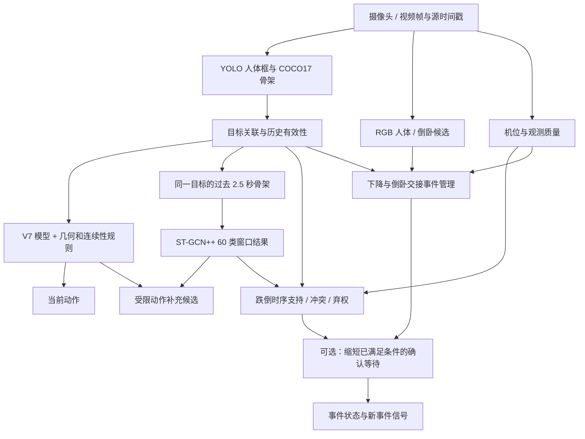
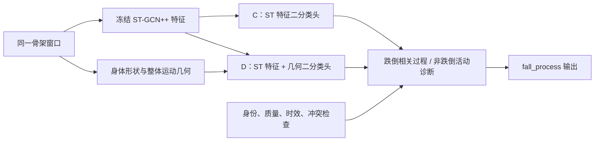
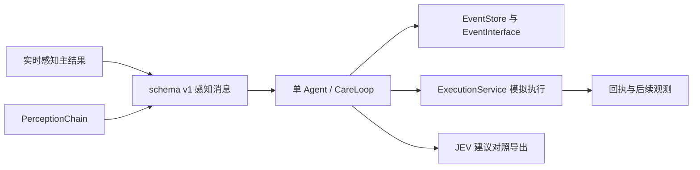

# FallPreAgent 代码架构

本文描述仓库当前实现，面向第一次接手开发的人。安装和运行见 [README](../README.md)，协作及测试见 [DEVELOPMENT](DEVELOPMENT.md)。项目的核心目标是用连续视觉证据改善跌倒事件识别；基础动作精度是诊断指标，不能代替事件漏检、误报、延迟和观测覆盖率。

## 1. 运行入口

| 入口 | 已实现的职责 | 当前边界 |
| --- | --- | --- |
| [摄像头演示服务](../scripts/webcam_pose_demo.py) + [网页](../assets/webcam/index.html) | 图像推理、目标关联、当前动作、跌倒事件、可选 ST-GCN++ 证据及受限事件融合 | 当前视觉主线；不自动执行对外报警；不包含实验二分类头 |
| [PerceptionChain](../src/fallpre/weekly/perception_chain.py) + [JSONL 回放入口](../scripts/replay_perception_chain.py) | 将基础观测和时序结果组装为明确的感知工具输出，比较动作、过程判别、事件与通知 | 新链路的离线入口；实验二分类头没有报警决定权；尚未替换摄像头服务的完整输出协议 |
| [单 Agent 回放](../scripts/replay_care_agent.py) / [CareLoop](../src/fallpre/care_loop.py) | 消费 schema v1 事件与观测，持久查询、去重、模拟提醒和报警 | 摄像头以显式适配或 JSONL 回放接入；JEV 单独做建议对照 |
| [CLI](../src/fallpre/cli.py) / [MVPService](../src/fallpre/service.py) | 早期 `Snapshot` 协议、风险规则及模拟工具 | 旧 MVP 独立入口 |

`src/fallpre/weekly/` 虽然沿用实验阶段的目录名，但包含当前摄像头主线，不能把整个目录视为可删除的历史代码。`action_v2` 到 `action_v7` 之间也存在实际导入关系。带日期的实验脚本保留用于追溯，其默认输入可能属于原开发机；它们不是新成员的安装入口。

## 2. 摄像头主线：图像到当前动作和事件

图中“目标关联”是视频内的连续目标跟踪，不是识别某位老人身份的人脸识别。当前动作目标与跌倒交接目标各自有身份编号；两个编号相等不代表同一人，跨分支必须检查当前空间关联和时间一致性。

主要模块如下：

| 模块 | 职责 |
| --- | --- |
| [webcam_pose_demo.py](../scripts/webcam_pose_demo.py) | HTTP 服务、模型加载、按视频流保存 `LiveSession`、组装结果 |
| [webcam_quality.py](../src/fallpre/weekly/webcam_quality.py) | 机位稳定性与当前观测质量；机位变动不能静默当成新的可信基准 |
| [webcam_target.py](../src/fallpre/weekly/webcam_target.py)、[webcam_fall_target.py](../src/fallpre/weekly/webcam_fall_target.py) | 动作目标与跌倒目标的关联、丢失和重新建立 |
| [webcam_actions.py](../src/fallpre/weekly/webcam_actions.py)、[action_v7.py](../src/fallpre/weekly/action_v7.py) | 基础动作模型、几何约束与连续状态 |
| [webcam_behavior.py](../src/fallpre/weekly/webcam_behavior.py) | 姿态、移动、转向等辅助上下文 |
| [webcam_fall_handoff.py](../src/fallpre/weekly/webcam_fall_handoff.py) | 已观测姿态、下降、RGB 倒卧候选之间的交接，事件确认和恢复 |
| [stgcn_temporal.py](../src/fallpre/weekly/stgcn_temporal.py)、[webcam_temporal.py](../src/fallpre/weekly/webcam_temporal.py) | 骨架窗口、预处理、ST-GCN++ 推理、异步结果新鲜度检查 |
| [stgcn_fusion.py](../src/fallpre/weekly/stgcn_fusion.py) | 当前动作的受限时序补充，不接管报警 |
| [stgcn_fall_evidence.py](../src/fallpre/weekly/stgcn_fall_evidence.py) | 跌倒过程的支持、冲突和弃权证据，不直接改变事件 |
| [fall_event_fusion.py](../src/fallpre/weekly/fall_event_fusion.py) | 在现有交接事件管理上应用受限时序支持，并保留基线比较 |

### 时间、身份与骨架输入

- 规则和历史窗口使用视频的源时间，不用推理耗时替代视频时间。视频跳转、目标切换、机位变化或长时间中断后，旧窗口不能继续代表当前目标。
- 默认窗口最多回看 2.5 秒，至少需要 1.5 秒跨度和 8 次真实观测；准备输入时采样为 100 个时间位置。100 个位置不是 100 次真实观测。
- 只使用窗口结束时已经出现的骨架。插值受关节可信度、画面边界和间隔约束，不补造遮挡关节，不向未来外推。
- ST-GCN++ 使用与现有权重匹配的 COCO17 图像坐标归一化输入，包含关节置信度。当前实现没有把全部坐标改成以人体中心为原点；改变输入定义必须同时调整训练和评估。
- `target_epoch` 表示这次关联目标的有效身份阶段，`generation` 表示有效窗口代次。异步结果须匹配两者且未过期才能参与当前判断。
- 两条分支共享 YOLO 骨架。模型与规则一致可以提供稳定性证据，但不能当成两个独立传感器相互证明。

### 融合究竟改变什么

摄像头入口的开关应按职责理解：

| 开关 | 行为 |
| --- | --- |
| 默认 ST 分支 | 显示过去窗口的 60 类结果；`--no-temporal` 可关闭 |
| `--fusion-shadow` | 输出当前动作的融合候选，保留主动作结果 |
| `--fall-temporal-shadow` | 输出跌倒时序支持、冲突与弃权理由 |
| `--fall-event-fusion` | 仅 RGB 跌倒模式可用；在基线事件条件成立时有限改变最终确认等待，保存基线与候选结果 |

当前动作的规则不是“两个分数平均”：已知的现有动作保持原判；原动作未知时，只有坐下/起身的时序类别、历史起点和当前身体运动相符，才允许给出相应动作补充。它没有把 NTU60 的所有类别转换成实时动作标签，也不会因为 ST 的跌倒分数高就覆盖蹲姿。

跌倒事件融合也不是二分类头直接报警。现有策略要求同一目标的已观测下降和倒卧交接成立，时序证据当前有效且没有冲突，才把最后确认等待从 1.0 秒缩短到 0.6 秒。支持证据的短期保留受身份和时间约束。多人、目标不确定、骨架不足、机位不稳定或证据冲突不能被高模型分数绕过。这些时长是当前代码参数，不是对所有视频报警延迟的承诺。

## 3. 新的感知工具协议：PerceptionChain

[PerceptionChain.update(result, t)](../src/fallpre/weekly/perception_chain.py) 接收的是已经整理好的基础观测，不直接接收图片。输入包含画面尺寸、姿态候选、当前目标、动作、质量、RGB 候选、跌倒交接观测，以及可选的 `temporal` 结果。它复制输入后计算候选，便于保存原始基线。

[回放入口](../scripts/replay_perception_chain.py) 以 JSONL 为边界，默认复用记录中的时序结果；启用实际时序推理时才需要额外权重和依赖。零散的骨架坐标或者旧工具的 `Snapshot` 都不等于这里的完整输入。新成员可以先用合成数据验证输出协议，不必先拿到个人视频。

### 二分类判别层的位置

[PerceptionRuntime](../src/fallpre/weekly/perception_chain.py) 提取冻结网络的 256 维特征。C 头仅使用该特征，D 头再加入 21 维几何特征；权重来自已有的 URFD 弱标签开发实验。当前输出采用 D 头的类别结果，同时保留 C/D 原始分数供诊断。[stgcn_fall_head.py](../src/fallpre/weekly/stgcn_fall_head.py) 提供训练相关代码。

这些分数是未经校准的“已观测过程分类分数”，不是未来跌倒风险，也不是可靠性分数。当前 `fall_process.changes_alarm` 固定为 `false`。判别层不能凭高分制造报警；它是否值得接管更多职责，要由独立事件评估决定。

过程判别要求当前唯一且对应的人体目标、可用骨架、有效时序结果与无冲突几何。它不要求 RGB 已经判为倒卧，否则正常活动就无法分类；但它同样不能把另一个人体候选忽略掉以提高覆盖率。

### 各输出分别供谁使用

| 字段 | 意义 | 不能作出的推断 |
| --- | --- | --- |
| `identity`、`source_time_s` | 当前目标阶段、窗口代次和源时间 | 不是永久老人身份，也不是服务器接收时间 |
| `observation` | 当前动作是否可观测，事件是否可判断 | 看不清不等于没有跌倒 |
| `current_action` | 由现有规则及受限补充得出的当前动作 | 不是把 2.5 秒内最高类别直接贴在此刻 |
| `temporal_action` | 过去窗口的 60 类结果、窗口和有效性 | 不是当前姿态，不是事件确认 |
| `fall_process` | 二分类头诊断、几何和冲突、受限时序支持 | 不是可直接执行的报警命令 |
| `event` | 疑似、确认、恢复、事件键及生命周期 | 状态为正常不能抹掉事件历史；丢失目标不能证明恢复 |
| `notification` | 此次是否出现一个应通知的新事件、幂等键 | `emit=true` 也不表示已经发出外部通知 |
| `display` | 框、颜色与动作文字 | 绿框表示动作目标可观测，不是“已经证明安全” |

事件可判断与动作可观测是不同条件：例如目标站立清楚，可以显示绿色动作框，但跌倒交接历史尚不足，事件仍可能不可判断。灰色表示当前动作观测不足；黄色/红色由疑似/确认事件驱动。旧目标丢失后不能留下它的框冒充当前观测。

### 去重、恢复与误报

`PerceptionChain` 的事件键采用 `stream_id/event_id`，同一对象生命周期内只对同一事件发一次新事件信号。`delivered` 目前是内存集合；进程重启后没有持久去重保证。部署时流标识还须区分不同采集会话，防止新的会话复用旧事件键。

“一次错误事件发了三次通知”是重复通知；“正常坐下产生了一次跌倒事件”是错误事件。去重能减少前者，不能消除后者。减少误报还依赖可靠观测、时序与几何冲突处理以及独立负样本评估。

只有明确的当前恢复证据才能报告恢复。代码区分站立/坐姿恢复、低位支持状态和恢复中；目标消失不是恢复。面向智能体的输出应保留这些差异，不能只发送一个 `fall: true/false`。

## 4. 单 Agent 双策略

实时适配从主事件输出提取确认、身份和恢复信息。末段 ST＋几何影子服务的日志附带同一格式的 `perception` 对象。Agent 依据上游确认事件执行模拟报警，依据可见且连续的坐姿到起身观测执行普通提示。事件键、处理状态、恢复和执行回执的字段及演示命令见 [单 Agent 交接](care-agent-20261110.md) 与 [架构图](assets/single-agent-tools-20261111.html)。

[FallPreventionAgent](../src/fallpre/agent.py) 通过 `describe_tools()/invoke()` 调用所选后端导出的工具。新感知走 `CareLoop` 的 `observe`，旧 `Snapshot` 和 `inspect_person` 仍走 `MVPService`。两条入口共享执行组件，业务规则由各自的上游负责。

## 5. 当前工程边界

- 已有受约束的时序证据与离线判别头，尚未证明养老院长期运行误报率，也没有完成新人物、新机位的独立泛化验证。
- 私有录像、人工标签、实验模型和历史报告不随代码仓库发布。模型资源按 [资源清单](../configs/runtime-resources.json) 单独准备；缺失资源应明确报告。
- 多人和身份不确定时保留保护。不能通过固定房间区域屏蔽检测，或放松唯一目标要求来把覆盖率“做高”。[nonhuman_appearance.py](../src/fallpre/weekly/nonhuman_appearance.py) 属于已有离线外观研究，不代表实时服务已经具备通用的玩偶排除能力。
- 后续优先围绕事件漏检、每有效监测小时误报、源时间报警延迟、重复事件/错误恢复、观测覆盖及跨人跨机位差异评估。合成测试证明的是规则边界与协议行为，不等于真实场景效果。
