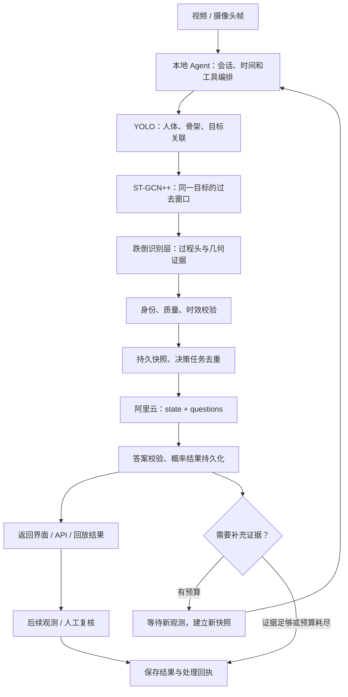

# 视频跌倒识别 Agent 与阿里云决策模型实施方案

日期：2026-11-17。状态：待开发实施。本次交付为接口与流程设计、配置模板；未修改识别算法、未接通云端，也未验证真实识别效果。

目标：用户输入视频或摄像头帧，单个本地 Agent 编排 YOLO → ST-GCN++ → 跌倒识别层 → 证据校验与持久去重 → 阿里云决策模型，返回带证据、时效和来源的跌倒概率估计；证据不足时继续观察并有限重评。首版交付范围是“识别、评估、返回、继续观察”的闭环，沿用已有模拟执行能力。

## 1. 已核实的模型接口

阿里云的 `decision-model-preview` 接收文本或序列化业务状态，不支持 Function Calling。由 Python Agent 调度视觉工具，模型承担结构化判断。官方通用“结构化输出”能力栏标记不支持，但专用决策接口具有固定的类型化答案合同；开发时以专用 API 为准。[模型说明](https://help.aliyun.com/zh/model-studio/decision-model-preview)

采用 HTTP POST `https://{WorkspaceId}.{region}.maas.aliyuncs.com/compatible-mode/v1/systemone`，北京地域为 `cn-beijing`。请求头使用 Bearer API Key，请求体为 `model + state + questions`。`noul` 返回 `P(yes)`，`choice` 返回选项、分布及置信度；模型不生成解释文本。它不是 `/chat/completions` 接口。这里的协议依据是 [阿里云决策模型 API](https://help.aliyun.com/zh/model-studio/decision-model-api)，核实日期为本方案日期。

首版建议使用项目已有的标准库 HTTP 适配方式，固定 URL 拼接与合同测试，减少依赖变动；若开发窗口改用官方 SDK，需按实施当日文档核对支持版本。真实空间权限、模型开通、地域匹配、时延和配额须在接入时验证，当前没有 API Key，未做真实调用。

## 2. 对“概率”和闭环的定义

本方案将输出目标固定为 `observed_fall_in_window`：给定指定人物、指定源时间窗口的证据，该窗口内是否发生了跌倒过程。它不表示未来若干秒会跌倒的概率，也不表示当前仍倒地或尚未恢复。

- `fall_probability_raw`：决策模型的 `answers.fall_occurred.noul`。
- `fall_probability_calibrated`：未来在独立标注集上校准后的估计；首版为 `null`。
- `fall_probability`：首版等于有效的 raw 值，且 `probability_kind=uncalibrated_model_estimate`；完成校准后才允许切换为 calibrated，并附校准版本。
- 质量不足、结果过期、未运行、失败时，当前 `fall_probability=null`，不能填 0、0.5 或沿用另一人的值。
- ST 的 60 类分数、实验二分类头分数、模型答案置信度分别保留，不能相互替代，也不能无验证地加权平均。

例如“0.86”只能在界面标为“模型估计跌倒概率 86% · 未校准 · 窗口 9.8–12.3 秒”。已经确认的事件即使移出这个窗口，事件历史仍保留；后续窗口的低分不能撤销确认或证明恢复。只看到画面开始时倒卧、却没有跌倒过程证据，应保留 `insufficient` 和原有倒卧/事件观测。



“继续观察”必须取得新的帧或窗口，不能把同一批证据反复询问模型。人工复核用于离线评估，不自动修改在线模型权重。

## 3. 现有代码如何复用

| 现有位置 | 已有能力 | 本轮接入方式 |
| --- | --- | --- |
| `scripts/webcam_pose_demo.py` 的 `PoseEngine.infer_live` | JPEG 视频帧、YOLO、源时间、目标管理、异步 ST | 复用作为本地感知工具；云端等待移到推理锁外 |
| `weekly/stgcn_temporal.py`、`webcam_temporal.py` | 2.5 秒窗口、至少 1.5 秒跨度和 8 次真实观测、epoch/generation 过滤 | 沿用预处理、窗口及失效规则，不改变训练输入 |
| `weekly/tail_process_shadow.py` | 当前末段 ST＋几何 286 维实验头 | 首版实时接入优先选 `tail_joint`；资源缺失明确报告 |
| `weekly/perception_chain.py` | schema v1 感知合同、C/D 头、过程和事件输出 | 离线合同参考与回放；C/D 通过显式 `cd` 配置选择 |
| `care_loop.py` 的 `live_perception_payload` | 实时主结果 → schema v1 | 扩展独立证据适配器；现有适配缺少完整 ST 窗口与质量明细 |
| `event_store.py`、`event_interface.py` | 持久事件、源时间快照、处理状态、模拟通知去重 | 保持原语义，旁挂决策任务与结果表 |
| `care_loop.py`、`agent.py` | 单 Agent 观察、查询工具、模拟动作 | 增加新编排入口并复用；保持旧调用兼容 |
| `adapters/jev_suggestions.py` | 类似 `state + questions` 适配、可注入 transport | 参考其分层，新增 Aliyun provider；不把 JEV 的 Key 或 URL 混用 |

特别注意：`PerceptionChain.update()` 会运行自己的事件融合，不能在已运行 `PoseEngine` 主事件链后再用它覆盖主事件。实时路线采用一个主事件拥有者，旁路提取过程头和证据；离线路线可以独立使用 `PerceptionChain`。两条路线转换成同一决策证据合同。

最新 `tail_joint` 与 C/D 头的特征、权重不同，不得静默替换。`--no-temporal` 或缺失所选过程头时，既有视觉服务可继续运行，但此次 Agent 的完整链路必须标为 `degraded`，不能声称 ST/识别层已运行。

## 4. 模块与工具接口

使用单进程编排器、已有 ST 工作线程、独立决策 HTTP worker 和一个数据库拥有者；暂不拆微服务，也不引入额外通用聊天模型。

建议新增：

```text
src/fallpre/decision_contracts.py        # Pydantic 请求、证据、结果合同
src/fallpre/decision_config.py           # 环境配置与凭据缺失检查
src/fallpre/decision_evidence.py         # live / replay 的无副作用适配与校验
src/fallpre/decision_store.py            # 决策任务、结果、重评关系与反馈
src/fallpre/decision_loop.py             # 编排、调度、状态机与当前结果投影
src/fallpre/adapters/aliyun_decision.py  # URL、请求、响应校验与错误分类
scripts/replay_decision_agent.py        # 合成 / 观测 JSONL 回放
tests/test_decision_*.py                # 合同、边界、恢复与 provider 模拟
```

内部接口建议：

```python
class DecisionProvider(Protocol):
    def assess(self, evidence: DecisionEvidence, *, deadline: float) -> ProviderResult: ...

class DecisionLoop:
    def observe(self, session_id: str, perception: dict, evidence: DecisionEvidence) -> dict: ...
    def accept_result(self, task_id: str, result: ProviderResult) -> dict: ...
    def latest(self, run_id: str) -> DecisionView: ...
    def feedback(self, decision_id: str, request: FeedbackRequest) -> dict: ...
```

| 工具名称 | 输入 → 输出 | 调用约束 |
| --- | --- | --- |
| `perception.analyze_frame` | image、stream、source_time → 主感知结果 | 本地可信代码调用；帧不出本机 |
| `temporal.get_window_result` | stream、epoch、generation、window → ST 结果 | 读取共享 ST 结果，避免重复推理 |
| `fall_head.get_evidence` | 同一窗口结果 → 原始头分数、几何、有效性 | 使用锁定的头版本，不授予报警权限 |
| `evidence.validate` | 完整证据 → eligible、reason_codes | 确定性检查，不由云模型绕过 |
| `decision.assess` | 已验证 Evidence → 模型答案 | 唯一允许调用云端的工具 |
| `observation.wait_next` | run、after_time、timeout → 新快照或结束 | 最多一次附加观察，不主动快进视频 |
| `decision.publish` | 已校验答案 → 持久结果与查询回执 | 先写库再可见，标明源窗口 |

这些工具是本地 Python 接口；模型只在预设 `next_step` 枚举内建议下一步，编排器验证后执行，不接受任意工具名、命令或模型返回的 URL。

## 5. 决策证据合同

保留原感知 `schema_version=1`。新增 `DecisionEvidence.schema_version="decision-evidence.v1"` 包装层，不把决策结果写回原感知对象，避免同一源时间重复入库时摘要冲突。

| 字段组 | 必需内容 |
| --- | --- |
| 关联 | run_id、session_id、stream_id、snapshot_id、decision_id、request_digest |
| 身份 | action_epoch、generation、fall_target_epoch（可空）、跨分支关联结果 |
| 时间 | source_time_s、window_start_s、window_end_s、实际观测数量、ST 完成时点；本地入队/完成单调时钟与 UTC 审计时间分开 |
| 质量 | observable、event_decidable、camera_stable、person_count、pose 有效率、连续性、缺失原因 |
| 视觉/时序 | 当前动作、ST top3 与相关类别分数、窗口信息；每项必须带 status |
| 识别层 | head_variant、weights_sha256、raw_score、几何摘要、冲突、实验属性 |
| 事件 | 当前主事件状态、持久 event_key（可空）、恢复状态、事件转移、alarm_authority |
| 来源 | YOLO/ST/头版本、预处理版本、prompt_version、policy_version、共享骨架标记 |

数据映射需逐项写测试。当前实时简化适配器没有携带 `identity.generation` 或完整时序窗口，应从 `result.temporal` 和相关 buffer 的已验证输出补齐；缺少时弃权，不能填默认 0。动作 epoch 与跌倒目标 epoch 不能只凭数字相等认定同一人。

云端 `state` 只取上述证据的必要摘要：相对时间、匿名目标编号、状态、模型分数、质量、几何、近期有限历史。请求摘要与本地关联 ID 在本地保存；不发送视频、图片、完整骨架序列、个人姓名、本地路径或自由文本人工备注。

云端请求示例（示意值，不是实际推理记录）：

```json
{
  "model": "decision-model-preview",
  "state": {
    "task": "observed_fall_in_window",
    "window": {"start_s": 9.8, "end_s": 12.3, "observed_frames": 20},
    "quality": {"observable": true, "camera_stable": true, "unique_target": true, "continuous": true},
    "temporal": {"status": "ready", "same_target": true, "falling_class_score": 0.71},
    "fall_process": {"status": "experimental", "head_variant": "tail_joint", "raw_score": 0.82, "descent_observed": true, "low_pose_observed": true, "conflicts": []},
    "event": {"state": "suspected", "recovery_status": "not_established"},
    "shared_pose_evidence": true,
    "score_semantics": "raw model scores are uncalibrated; missing observations are unknown"
  },
  "questions": {
    "fall_occurred": {
      "type": "noul",
      "instructions": "仅根据指定窗口内该目标的已观测证据，判断是否发生跌倒过程。区分主动坐下、躺下、弯腰、蹲下与跌倒。共享骨架的规则和模型不是独立证据。不要预测未来。"
    },
    "evidence_sufficiency": {
      "type": "choice",
      "instructions": "现有证据是否足以判断这个窗口内发生了跌倒过程？",
      "criteria": {
        "sufficient": "目标连续且能区分跌倒与正常动作，证据没有关键缺口",
        "insufficient": "缺少关键过程、观测或语义证据",
        "conflicting": "动作、几何、时序或事件证据冲突"
      }
    },
    "next_step": {
      "type": "choice",
      "instructions": "选择后续步骤；不能执行报警、撤销事件或认定身体已经恢复。",
      "criteria": {
        "emit_result": "当前证据足够，返回本次判断",
        "observe_more": "补充新的连续观测可能解决不确定性",
        "request_review": "现有证据难以消除歧义，保存待人工复核"
      }
    }
  }
}
```

完整生产请求的 state 由证据构建器产生，包含第 5 节的版本和实际可用摘要。问题定义固化为 `prompt_version`。示例中的语义字段必须对应可追溯观测，不能依据头分数反推 `descent_observed=true`。

答案解析必须检查三个答案存在且类型一致、枚举属于请求、概率为有限数且在 [0,1]，拒绝 bool 冒充数值。对 choice 检查完整分布、总和在容差内（建议 1e-4）及合法 confidence。保留服务 request_id、model、usage、latency_ms；客户端另测全程耗时。不要假设 noul 带 confidence。

若模型判证据 insufficient/conflicting，或“sufficient + observe_more”等回答与最终发布规则冲突，当前概率置空，raw 仅作审计；有限补采或转复核。自然语言说明由本地 reason_codes 模板生成，不能声称来自模型解释。

## 6. 本地 API 与返回合同

首版复用现有 Safari 页面的视频选择、解码和 `POST /infer` JPEG 通道，不再上传完整视频到另一个服务。对既有 `/infer` 保持原输入输出兼容，通过新增 `X-Agent-Run-Id` 显式接入，响应附加 `agent` 字段。未启用 Agent 的页面不受影响。

| 接口 | 合同 |
| --- | --- |
| `POST /api/v1/agent/runs` | `{request_id, source_type: camera\|video}` → `{run_id, session_id, stream_id, provider, stages, status}`；服务端创建关联标识 |
| `POST /infer`（已有） | JPEG + 现有 X-Stream-Id / X-Source-Time / X-Source-Type 等头 + 新 run 头；快速返回感知和决策任务状态 |
| `GET /api/v1/agent/runs/{run_id}/latest` | 当前最新观测及与之匹配的可用决策；建议界面 500ms 轮询，避免首版增加 WebSocket |
| `GET /api/v1/agent/runs/{run_id}/decisions?after_id=…&limit=…` | 按单调结果 ID 分页，保留历史/迟到/失败结果，不丢失事件 |
| `POST /api/v1/agent/runs/{run_id}/stop` | 停止接收，等待已提交任务至截止或标为取消；返回查询地址，历史仍可访问 |
| `POST /api/v1/agent/decisions/{decision_id}/feedback` | `{request_id, expected_version, label, note}`；label 为 fall/non_fall/uncertain；独立人工标签表 |

创建 run 的 request_id 重试返回原 run，相同 ID 不同内容返回 409。run 与 stream 必须绑定；生产者重启、视频 seek、时钟重置新建 run/session。决策 worker 或消费者单独重启沿用已有 session。新接口保留现有回环地址、Host、Origin、X-Session-Token 验证；不能开放浏览器提交任意 `alarm_authority` 或服务端文件路径。GET 不能仅凭知道 run_id 越过会话验证。

帧级重试在 Agent 包装入口按 `(run_id, source_time_s, image_digest, inference_options)` 识别，必须在调用 `infer_live` 前完成，因为现有引擎拒绝重复时间戳。同时间相同内容返回原帧 receipt；不同内容/选项返回 409；时间倒退要求新 run。新源时间的新画面按正常观测处理，不由 event 去重吞掉。

示例是已完成且可供当前视图使用的结果；ID、分数均为占位示例：

```json
{
  "schema_version": "agent-decision.v1",
  "run_id": "run-demo",
  "session_id": "producer-demo",
  "stream_id": "stream-demo",
  "decision_id": "decision-demo",
  "snapshot_id": 123,
  "identity": {"action_epoch": 7, "generation": 3},
  "source_window": {"start_s": 9.8, "end_s": 12.3},
  "status": "ready",
  "provider": "aliyun",
  "model": "decision-model-preview",
  "fall_probability": 0.86,
  "fall_probability_raw": 0.86,
  "fall_probability_calibrated": null,
  "probability_kind": "uncalibrated_model_estimate",
  "probability_target": "observed_fall_in_window",
  "evidence_sufficiency": "sufficient",
  "next_step": "emit_result",
  "event_key": null,
  "event_state": "suspected",
  "changes_alarm": false,
  "current_applicable": true,
  "reason_codes": ["UNVALIDATED_CALIBRATION"],
  "external_action_performed": false
}
```

外层感知状态可以 confirmed，内层 decision 可以 unavailable，两者互不覆盖。`event_key` 为 null 时仍能评估正常/疑似窗口；不能只在 confirmed 后才请求模型，否则没有真正的识别评估用途。

统一结果状态：`pending / ready / insufficient / unavailable / stale / skipped / cancelled`，分别保留 reason_codes。关闭 provider 时 skipped，mock 时必须显示 provider=mock 且 probability_kind=synthetic_fixture，不得展示成真实模型评估。校验失败 HTTP 400/422，关联冲突 409，输入超量 413/429；云端失败通过决策状态呈现，不使本地视频链路崩溃。

## 7. 校验、去重、异步和反馈闭环

### 7.1 三层去重

1. 帧/观测去重：沿用 EventStore 的 `(session, stream, source_time)` + payload 摘要。相同输入重试返回原结果；同时间不同内容拒绝。
2. 决策去重：唯一键为 `SHA256(provider + model + prompt_version + policy_version + canonical_evidence)`。canonical_evidence 包含 session、stream、epoch、generation、窗口、模型/头版本及有效证据，不包含请求耗时、入库时间、随机 request_id。同一证据只创建一个任务；证据变化产生新 revision。
3. 事件/执行去重：复用 EventStore 的持久 event_key 与 ExecutionService 的执行回执。一件持续跌倒可以得到多个新窗口判断，但只有一件主事件；不能用“每 30 秒一个报警”的冷却代替事件去重。

数据库约束负责并发唯一性。先提交快照及决策工作项，再发网络请求；结果通过队列回到数据库拥有者提交。现有 SQLite 连接及 CareLoop 采用同步拥有者，不能把同一连接交给 HTTP worker。

快照入库与决策登记若跨两次事务，在重启时按“已接受但没有调度登记的 snapshot_id”扫描补齐；每条快照都记录 scheduled/skipped/insufficient 之一，避免崩溃漏任务。若重构成同事务，另加回归验证原事件 outbox 不变。任务使用待执行/执行中/完成状态、租约及有界重试，网络调用期间不持有数据库事务。

本地只接受一个逻辑结果。云端未声明幂等请求能力，崩溃在响应收到但写库前可能造成重复调用/计费，不能承诺云端 exactly-once。传输错误重试沿用同一证据与 task_id，并记录 attempt。

### 7.2 确定性质量门与调度

- 强制检查同一目标、唯一人体、机位稳定、有效骨架、连续窗口、ST epoch/generation 匹配与模型资源齐备。保留既有 `.6 秒` ST 对触发观测的新鲜度检查，它不等于云请求超时。
- 缺失关键数据直接 insufficient；语义冲突但数据完整可进入模型复核，同时明确 conflicts。模型不能修复断裂身份或伪造骨架。
- 首个完整合格窗口请求一次。正常情况下至少间隔 2 个源时间秒重新抽样，新的疑似/确认/恢复转移优先调度。所有关键转移先持久化，不因合并普通窗口而丢失。
- 首版每流最多一个 HTTP 任务在途；普通待处理窗口保留最新一个，关键转移单独排队。全局默认一个决策 worker；队列满返回明确 skipped/backpressure 并保留审计。
- `observe_more` 等待至少约 1 秒新连续观测后创建子决策，最多一次；视频结束、失去目标、超预算时以 insufficient/request_review 结束。最大等待建议 5 秒墙钟，暂停视频不无限挂起。
- 新观测和人工反馈追加记录，记录 parent_decision_id、证据变化及模型调用次数。模型自己的上一轮概率不作为新的视觉证据再次输入，避免自我强化。

上述间隔为开发初值，不是效果验证阈值。2.5 秒窗口内至少 1.5 秒跨度属于现有 ST 约束；真正低延迟取决于模型推理、采样与网络实测。

### 7.3 历史结果与当前结果分开

每个返回值永久绑定触发它的快照和窗口。迟到结果可保存到历史，但更新当前视图须检查 run/session 未停止、身份/代次仍匹配、未发生新的关键状态转移、结果次序未倒退，且源时间年龄和墙钟年龄均在预算内。默认最大源时间年龄 2.5 秒、墙钟年龄 5 秒，重启后未确认时效的结果仅供历史查看。

新快照的 ID 变化本身不立即否定上一个结果，但其 source_window 必须持续可见；质量丢失、换人或 generation 变化立即清空当前概率。历史高概率不能贴给当前人物。录像加速回放时以各快照的结果做历史统计，不把慢网络返回的结果伪装成实时。

### 7.4 网络错误和降级

一个任务的 HTTP 总预算初值 3 秒，含最多一次重试；只对连接类错误、429、可恢复 5xx 重试，退避带抖动，Retry-After 过长时结束本次任务。401/403、配置错误、无效合同不盲目重试。连续服务错误可短暂熔断（建议 5 次后 30 秒），只影响云决策。

无 Key/无空间 ID/超时/限流/模型权限不足分别记录 reason_code；当前概率为 null。原感知、主事件与模拟报警继续，不用原始 ST 分数或二分类头分数冒充云端概率。日志仅记录脱敏错误类别、服务 request_id 和时间，不打印 Key、Authorization 或未过滤的错误响应。

## 8. API Key 位置与配置加载

模板已放在仓库根目录 [`.env.example`](../.env.example)。实施后由开发者复制为根目录 `.env`，在本机填：

```dotenv
DASHSCOPE_API_KEY=
DASHSCOPE_WORKSPACE_ID=
DASHSCOPE_REGION=cn-beijing
FALLPRE_DECISION_MODEL=decision-model-preview
FALLPRE_DECISION_PROVIDER=aliyun
```

其中前两项需要真实值。Key 留在服务端，页面只看到 provider/model/configured 状态。`.env` 已被忽略；模板没有秘密。生产部署使用进程环境变量或密钥注入。

**配置加载属于待开发项**：现有项目没有这套 Aliyun 配置加载器，单纯填模板目前不会生效。开发时在 `decision_config.py` 明确加载根目录 `.env`（可新增固定版本 python-dotenv），优先级为进程环境变量 > `.env` > 非秘密默认值，禁止覆盖已有环境；不要要求通过 shell source 执行任意配置内容。

provider=off 默认不联网；mock 不读取 Key；aliyun 模式启动时检查 Key、workspace、允许地域及所选模型。云域名从配置中的合法 workspace/region 拼接，首版不接受任意 URL，也不把凭据转发到重定向域名。缺失时明确 degraded/config_missing；显式 CLI 真调用检查则非零退出。

模板中 timeout、max_retries、min_interval、source/wall age、max_reobservations、DB 路径均要有类型和范围验证。`.env.example` 仅含空 Key，不向聊天或截图索取 Key。新的 `.env.local` 等仍应被 Git 忽略。

## 9. 报警、概率、人工处理的边界

本阶段返回模型概率及复核建议；主事件的确认与恢复继续由当前视觉事件层提供。云模型高分不会直接确认事件，低分不会撤销已有事件，超时不会拦住已有模拟报警。实验头仍保持 `changes_alarm=false`。

`feedback.label` 是人工真值/待定标签；`EventInterface.set_processing` 是人工处理进度；上游 recovery 是身体恢复观测；执行 receipt 是动作是否完成。这四者分别存储，处理完成不能代表身体已恢复。首版没有短信、电话或第三方通知交付。

若下一阶段需要模型参与最终报警阈值，先完成独立标注、校准和事件级效果对比，再单独变更 policy_version 与权限。避免仅凭任意 0.8 阈值让未经验证的模型接管报警。

## 10. 开发顺序与验收

| 阶段 | 实施内容 | 可验收产物 |
| --- | --- | --- |
| P0 合同与配置 | 新 schema、provider 接口、.env 加载、off/mock、版本和错误枚举 | 无 Key 也可运行；字段、配置优先级和秘密屏蔽测试通过 |
| P1 本地闭环 | Evidence 适配、持久任务与结果、mock 回放、有限补采 | 连续观测 → 决策 → 返回 → 新观测重评；重复输入和重启无重复逻辑结果 |
| P2 阿里云适配 | 实际 System One 请求、类型校验、时限、限流与脱敏 | 用合成状态真实调用并保存 request_id；未配置时明确不通过真实调用验收 |
| P3 视频贯通 | 复用 /infer、完整 ST＋头资源、异步 provider、结果查询与 Safari 展示 | 实际授权视频进入完整链路；可见概率、窗口、质量、来源、降级和历史记录 |
| P4 概率评估 | 人工标签、分组留出、校准与门控策略评估 | 输出可靠性图、Brier/ECE、事件漏检/误报/延迟、观测覆盖率 |

P0–P3 是本次开发窗口的功能目标；P4 是将“未校准模型估计”升级为可信概率的前提。合成测试通过不等于 P3 真模型或 P4 准确率通过。

新增有意义的验收场景：

1. 同一输入重复提交、同时间不同内容、生产者重启、消费者重启、数据库并发竞争和崩溃恢复。
2. 正常站立/坐下、下降倒卧、多人、遮挡、机位移动、时间倒退、换目标、旧 generation、ST 缺失/过期、头缺失。
3. 非法返回：缺答案、错误类型、布尔分数、NaN/Inf、越界、概率和错误、未知选项、答案冲突。
4. 云端乱序、停止后返回、恢复后返回、已确认但云端低分、断网/401/429/5xx；当前视图不得串人或抹掉主事件。
5. observe_more 只能拿新证据且最多一次；EOF/暂停/质量丢失结束等待，不能无限循环。
6. 同一事件多个决策 revision 不重复执行；正常合格窗口也可得到结果，而非只评估已经确认的事件。
7. off/mock/aliyun 标记准确；前端、日志、导出不含 Key；仅允许必要结构化摘要出网。

沿用 `scripts/check_portable.py` 的可分享回归，并把新增合同测试纳入；涉及界面时可运行现有无需浏览器的 Node 检查。实际页面用 Safari 验证，不启动 Chrome/Chromium。用模型资源 doctor 确认 tail-shadow 或所选 C/D 路线；录像验证按现有授权素材与标注执行。

P4 对比“既有视觉事件基线”“模型原始判断”“校准及门控结果”，按人物/机位/视频分组划分训练、校准、测试集，禁止同视频相邻窗口跨集合泄漏。含正常活动和观测不足样本，报告弃权率，不能仅挑疑似跌倒样本计算整体准确率。事件迟延分别报告源时间和墙钟端到端 p50/p95，并给出模型调用数、缓存率和真实费用/用量。

## 11. 给开发窗口的执行指令

用户已确定分阶段实施和审核：开发窗口每次只完成当前阶段；本审核窗口检查代码、可复现实验和边界测试。未通过时给出具体问题、修改建议和复验项；通过后才提供下一阶段提示词。开发完成自查不等于审核通过，不自动连做后续阶段。

P0、P1 已在修订一通过，P2、P3 已在修订二通过。P4 修订五的离线评估工具和冻结批次盘点已通过，概率校准仍缺少独立人工标注数据。当前任务为 P4 人工标注与独立样本准备，见[第五阶段开发任务](agent-development-stage-05-20261118.md)。

2026-11-17 配置更新：用户提供的 CSV 已导入本仓库目录下被 Git 忽略的 `.env`，API Key、业务空间 ID 和北京地域均已填写；只记录此配置状态，不在文档中记录秘密。文件权限为 0600，provider 保持 off。已校验导出中的空间 ID 与地域网关一致；未发网络请求，空间模型权限、密钥有效性及调用效果仍待 P2 实测。开发窗口不得用空模板覆盖已有 `.env`。

模型资源继续使用现有清单；本次方案及配置任务未下载或变更模型。
